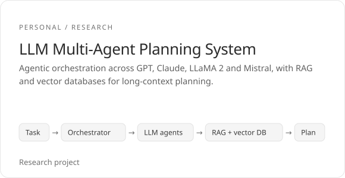
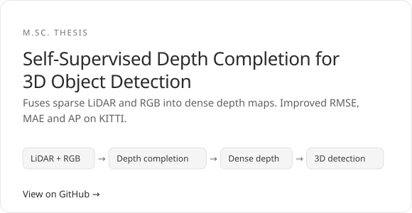
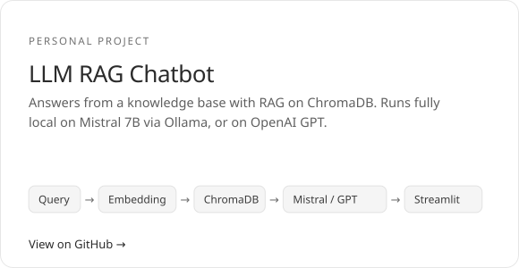
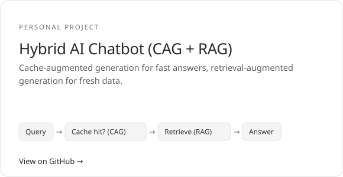
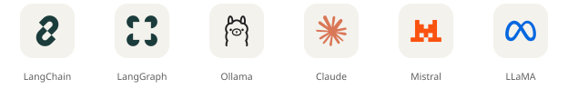
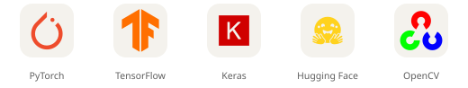
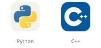
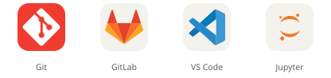

<picture>
  <source media="(prefers-color-scheme: dark)" srcset="assets/hero-dark.svg">
  <source media="(prefers-color-scheme: light)" srcset="assets/hero-light.svg">
  
</picture>

  &nbsp;&nbsp;
  &nbsp;&nbsp;
  

<b>I build production AI for industry and medicine.</b> 
Agentic AI, multi-agent orchestration, RAG and cloud delivery on GCP. Based in Taiwan.

 

## Activity

<a href="https://laihu08.github.io/Laihu08/">
<picture>
  <source media="(prefers-color-scheme: dark)" srcset="assets/isometric-dark.svg">
  
</picture>
</a>

<a href="https://laihu08.github.io/Laihu08/">Open interactive view →</a>

 

<!-- oss-contributions:start -->
## Open-source contributions

<table>
<tr><th>Project</th><th>Issue</th><th>Fix</th><th>Status</th></tr>
<tr><td align="center" width="170"><a href="https://github.com/headroomlabs-ai/headroom"> <b>headroom</b></a> </td><td>Valid compressed text was refused by the cache store Issue <a href="https://github.com/headroomlabs-ai/headroom/issues/4266">#4266</a></td><td>Refuse only a lone marker and keep real content, plus tests <a href="https://github.com/headroomlabs-ai/headroom/pull/4626">PR #4626</a> · 2026-11-04</td><td align="center"></td></tr>
<tr><td align="center" width="170"><a href="https://github.com/Q00/ouroboros"> <b>ouroboros</b></a> </td><td>LiteLLM requests sent the JSON schema in the wrong shape Issue <a href="https://github.com/Q00/ouroboros/issues/2807">#2807</a></td><td>Wrap the schema in the format LiteLLM expects, plus tests <a href="https://github.com/Q00/ouroboros/pull/2818">PR #2818</a> · 2026-11-03</td><td align="center"></td></tr>
<tr><td align="center" width="170"><a href="https://github.com/opensandbox-group/OpenSandbox"> <b>OpenSandbox</b></a> </td><td>Listing sandboxes loaded every sandbox before filtering Issue <a href="https://github.com/opensandbox-group/OpenSandbox/issues/2502">#2502</a></td><td>Filter in Kubernetes with label selectors, so only matches are loaded <a href="https://github.com/opensandbox-group/OpenSandbox/pull/2559">PR #2559</a> · 2026-11-03</td><td align="center"></td></tr>
<tr><td align="center" width="170"><a href="https://github.com/paperclipai/paperclip"> <b>paperclip</b></a> </td><td>MCP sign-in failed with servers that give no refresh token Issue <a href="https://github.com/paperclipai/paperclip/issues/18576">#18576</a></td><td>Accept code-only OAuth client registration, with full test coverage <a href="https://github.com/paperclipai/paperclip/pull/18589">PR #18589</a> · 2026-11-02</td><td align="center"></td></tr>
<tr><td align="center" width="170"><a href="https://github.com/paperclipai/paperclip"> <b>paperclip</b></a> </td><td>Webhooks sending both signature headers were wrongly rejected Issue <a href="https://github.com/paperclipai/paperclip/issues/18565">#18565</a></td><td>Check the secure SHA-256 signature first, plus a regression test <a href="https://github.com/paperclipai/paperclip/pull/18580">PR #18580</a> · 2026-11-02</td><td align="center"></td></tr>
<tr><td align="center" width="170"><a href="https://github.com/searchwork/nwt-reading"> <b>nwt-reading</b></a> </td><td>Year text overlapped &quot;days left&quot; with large iPhone fonts Issue <a href="https://github.com/searchwork/nwt-reading/issues/242">#242</a></td><td>Card text now scales with the system font size <a href="https://github.com/searchwork/nwt-reading/pull/255">PR #255</a> · 2025-03-04</td><td align="center"></td></tr>
<tr><td align="center" width="170"><a href="https://github.com/eidolonFIRE/xcNav"> <b>xcNav</b></a> </td><td>iOS app was missing permission descriptions Issue <a href="https://github.com/eidolonFIRE/xcNav/issues/222">#222</a></td><td>Declared location, Bluetooth and camera permissions <a href="https://github.com/eidolonFIRE/xcNav/pull/224">PR #224</a> · 2025-03-04</td><td align="center"></td></tr>
<tr><td align="center" width="170"><a href="https://github.com/firstcontributions/first-contributions"> <b>first-contributions</b></a> </td><td>First open-source step: join the contributors list Issue (no issue)</td><td>Added my name to the Hall of Contributors <a href="https://github.com/firstcontributions/first-contributions/pull/94961">PR #94961</a> · 2025-03-03</td><td align="center"></td></tr>
</table>
<!-- oss-contributions:end -->

 

## Experience

**01 &nbsp; AI Engineer II, [BizLink](https://www.bizlinktech.com/)** &nbsp;Aug 2025 – Present · Taiwan
- Built a multi-agent orchestration system for internal automation, from architecture to production on GCP.
- Integrated LLM, VLM and multimodal agents into real-time industrial workflows, served on Vertex AI.
- Containerised AI workloads with Docker and Kubernetes, shipped through MLOps CI/CD with evaluation, monitoring and guardrails.

**02 &nbsp; Senior Software Engineer, [Karma Medical Products](https://www.karmamedical.com/)** &nbsp;Oct 2021 – Jul 2025 · Taiwan
- Built AI posture-detection and pressure-alert systems from embedded sensor data.
- Automated actuator and sensor testing: manual QA time down 90%, remote testability up 75%.
- Worked with European teams on CE/FDA compliance.

**ED &nbsp; M.Sc. Electrical Engineering (ML/AI), National Chung Cheng University** &nbsp;2019 – 2021 · Taiwan
- Thesis: self-supervised depth completion for 3D object detection.

 

## Achievements

| | |
|---|---|
| **2 international patents** | Co-inventor in smart assistive technology, filed in the USA, Europe, Taiwan and India. |
| **2025 Taiwan Excellence Award** | For contributions to sensor-driven innovation. |

 

## Projects

  <picture>
    <source media="(prefers-color-scheme: dark)" srcset="assets/card-multi-agent-dark.svg">
    
  </picture>
  <a href="https://github.com/Laihu08/DepthCompletion-3DObjectDetection"><picture>
    <source media="(prefers-color-scheme: dark)" srcset="assets/card-depth-completion-dark.svg">
    
  </picture></a>

  <a href="https://github.com/Laihu08/llm-rag-chatbot"><picture>
    <source media="(prefers-color-scheme: dark)" srcset="assets/card-rag-chatbot-dark.svg">
    
  </picture></a>
  <a href="https://github.com/Laihu08/Hybrid-AI-Chatbot-CAG-RAG-"><picture>
    <source media="(prefers-color-scheme: dark)" srcset="assets/card-hybrid-cag-rag-dark.svg">
    
  </picture></a>

 

## Technology

<table>
  <tr>
    <td width="150"><b>AI & agents</b></td>
    <td><picture><source media="(prefers-color-scheme: dark)" srcset="assets/tech-ai-dark.svg"></picture> LLMs, VLMs, RAG, multi-agent orchestration, prompt engineering, vector databases, evaluation & monitoring</td>
  </tr>
  <tr>
    <td width="150"><b>Frameworks</b></td>
    <td><picture><source media="(prefers-color-scheme: dark)" srcset="assets/tech-frameworks-dark.svg"></picture></td>
  </tr>
  <tr>
    <td width="150"><b>Programming</b></td>
    <td><picture><source media="(prefers-color-scheme: dark)" srcset="assets/tech-programming-dark.svg"></picture></td>
  </tr>
  <tr>
    <td width="150"><b>Cloud & delivery</b></td>
    <td><picture><source media="(prefers-color-scheme: dark)" srcset="assets/tech-cloud-dark.svg"></picture></td>
  </tr>
  <tr>
    <td width="150"><b>Tools</b></td>
    <td><picture><source media="(prefers-color-scheme: dark)" srcset="assets/tech-tools-dark.svg"></picture></td>
  </tr>
</table>

 

## Certifications

<table>
  <tr>
    <th>Issuer</th>
    <th>Certification</th>
  </tr>
  <tr>
    <td align="center"> NVIDIA</td>
    <td><b>AI Infrastructure and Operations Fundamentals</b></td>
  </tr>
  <tr>
    <td align="center"> Robert H. Smith School of Business</td>
    <td><b>AI and Career Empowerment</b></td>
  </tr>
  <tr>
    <td align="center"> Microsoft</td>
    <td><b>Develop a RAG-based Solution with Azure AI Foundry</b></td>
  </tr>
  <tr>
    <td align="center"> Microsoft</td>
    <td><b>Evaluate Generative AI Performance in Azure AI Foundry</b></td>
  </tr>
  <tr>
    <td align="center"> Digital Workforce Services</td>
    <td><b>Understanding Agentic AI</b></td>
  </tr>
  <tr>
    <td align="center"> DeepLearning.AI</td>
    <td><b>LangChain for LLM Application Development</b></td>
  </tr>
  <tr>
    <td align="center"> Google Cloud</td>
    <td><b>Prompt Design in Vertex AI</b></td>
  </tr>
</table>
