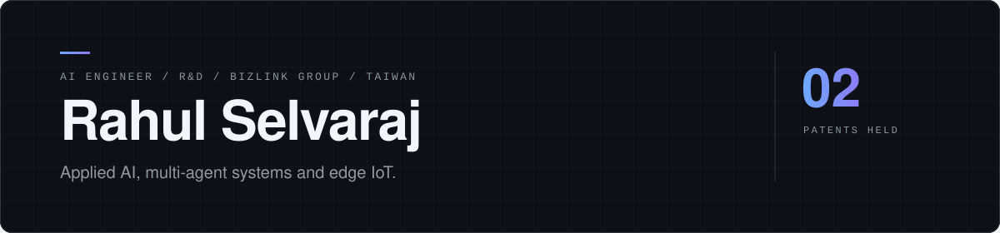

<picture>
  <source media="(prefers-color-scheme: dark)" srcset="assets/header-dark.svg">
  <source media="(prefers-color-scheme: light)" srcset="assets/header-light.svg">
  
</picture>

 

[Portfolio](https://laihu08.github.io/portfolio/) &nbsp;/&nbsp; [LinkedIn](https://www.linkedin.com/in/rahul-selvaraj) &nbsp;/&nbsp; [Email](mailto:srahul.india1998@gmail.com)

 

I work in R&D at BizLink Group, building machine learning and IoT systems for production use. I hold two patents, advise teams on applied AI, and contribute to open source.

 

### Focus

| | |
|---|---|
| **Agents** | Multi-agent systems and orchestration with LangGraph |
| **Retrieval** | RAG and CAG pipelines, and the trade-offs between them |
| **Language models** | Fine-tuning, NLP and deep learning |
| **Edge** | Embedded and IoT deployments of ML models |

 

### Selected work

| Project | Description |
|---|---|
| [llm-rag-chatbot](https://github.com/Laihu08/llm-rag-chatbot) | Local chatbot on Mistral 7B, Ollama and ChromaDB, with optional OpenAI support. |
| [DepthCompletion-3DObjectDetection](https://github.com/Laihu08/DepthCompletion-3DObjectDetection) | 3D object detection from LiDAR and RGB using self-supervised depth completion. |
| [CAG-vs-RAG](https://github.com/Laihu08/CAG-vs-RAG) | Cache-Augmented vs Retrieval-Augmented Generation, compared with worked examples. |
| [AI Agents in 2025](https://github.com/Laihu08/AI-Agents-in-2025-The-Evolution-Impact-and-How-to-Build-Your-Own-) | Hybrid agent workflows, learning-based approaches and how to build your own. |

 

### Tools

Python, PyTorch, LangChain, LangGraph, Ollama, ChromaDB, OpenAI API, Git, Linux

 

### Contact

Open to AI consulting, collaboration and open-source work. [LinkedIn](https://www.linkedin.com/in/rahul-selvaraj) is the quickest way to reach me, or write to [srahul.india1998@gmail.com](mailto:srahul.india1998@gmail.com).
