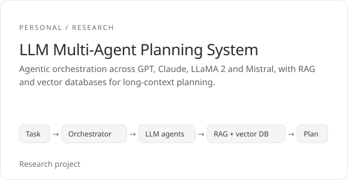
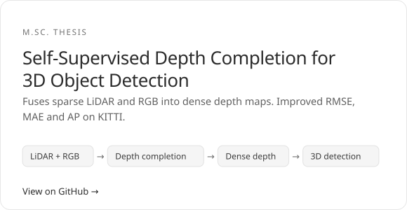
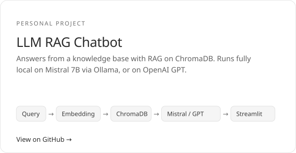
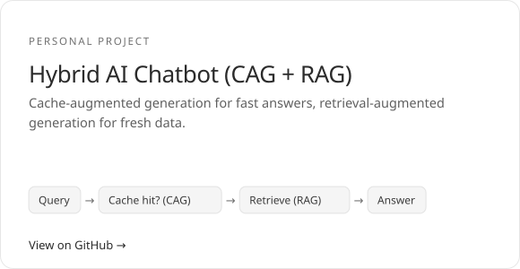

<picture>
  <source media="(prefers-color-scheme: dark)" srcset="assets/hero-dark.svg">
  <source media="(prefers-color-scheme: light)" srcset="assets/hero-light.svg">
  
</picture>

  &nbsp;&nbsp;
  &nbsp;&nbsp;
  

<b>I build production AI for industry and medicine.</b> 
Agentic AI, multi-agent orchestration, RAG and cloud delivery on GCP. Based in Taiwan.

 

## Experience

**01 &nbsp; AI Engineer II, [BizLink](https://www.bizlinktech.com/)** &nbsp;Aug 2025 – Present · Taiwan
- Built a multi-agent orchestration system for internal automation, from architecture to production on GCP.
- Integrated LLM, VLM and multimodal agents into real-time industrial workflows, served on Vertex AI.
- Containerised AI workloads with Docker and Kubernetes, shipped through MLOps CI/CD with evaluation, monitoring and guardrails.

**02 &nbsp; Senior Software Engineer, [Karma Medical Products](https://www.karmamedical.com/)** &nbsp;Oct 2021 – Jul 2025 · Taiwan
- Built AI posture-detection and pressure-alert systems from embedded sensor data.
- Automated actuator and sensor testing: manual QA time down 90%, remote testability up 75%.
- Worked with European teams on CE/FDA compliance.

**ED &nbsp; M.Sc. Electrical Engineering (ML/AI), National Chung Cheng University** &nbsp;2019 – 2021 · Taiwan
- Thesis: self-supervised depth completion for 3D object detection.

 

## Achievements

| | |
|---|---|
| **2 international patents** | Co-inventor in smart assistive technology, filed in the USA, Europe, Taiwan and India. |
| **2025 Taiwan Excellence Award** | For contributions to sensor-driven innovation. |

 

## Projects

  <picture>
    <source media="(prefers-color-scheme: dark)" srcset="assets/card-multi-agent-dark.svg">
    
  </picture>
  <a href="https://github.com/Laihu08/DepthCompletion-3DObjectDetection"><picture>
    <source media="(prefers-color-scheme: dark)" srcset="assets/card-depth-completion-dark.svg">
    
  </picture></a>

  <a href="https://github.com/Laihu08/llm-rag-chatbot"><picture>
    <source media="(prefers-color-scheme: dark)" srcset="assets/card-rag-chatbot-dark.svg">
    
  </picture></a>
  <a href="https://github.com/Laihu08/Hybrid-AI-Chatbot-CAG-RAG-"><picture>
    <source media="(prefers-color-scheme: dark)" srcset="assets/card-hybrid-cag-rag-dark.svg">
    
  </picture></a>

 

## Technology

<table>
  <tr>
    <td width="150"><b>AI & agents</b></td>
    <td><picture><source media="(prefers-color-scheme: dark)" srcset="assets/tech-ai-dark.svg"></picture> LLMs, VLMs, RAG, multi-agent orchestration, prompt engineering, vector databases, evaluation & monitoring</td>
  </tr>
  <tr>
    <td width="150"><b>Frameworks</b></td>
    <td><picture><source media="(prefers-color-scheme: dark)" srcset="assets/tech-frameworks-dark.svg"></picture></td>
  </tr>
  <tr>
    <td width="150"><b>Programming</b></td>
    <td><picture><source media="(prefers-color-scheme: dark)" srcset="assets/tech-programming-dark.svg"></picture></td>
  </tr>
  <tr>
    <td width="150"><b>Cloud & delivery</b></td>
    <td><picture><source media="(prefers-color-scheme: dark)" srcset="assets/tech-cloud-dark.svg"></picture></td>
  </tr>
  <tr>
    <td width="150"><b>Tools</b></td>
    <td><picture><source media="(prefers-color-scheme: dark)" srcset="assets/tech-tools-dark.svg"></picture></td>
  </tr>
</table>

 

## Certifications

| Issuer | Certification | Year |
|---|---|---|
| NVIDIA | AI Infrastructure and Operations Fundamentals | 2026 |
| Robert H. Smith School of Business | AI and Career Empowerment | 2026 |
| Microsoft | Develop a RAG-based Solution with Azure AI Foundry | 2025 |
| Microsoft | Evaluate Generative AI Performance in Azure AI Foundry | 2025 |
| Digital Workforce Services | Understanding Agentic AI | 2025 |
| DeepLearning.AI | LangChain for LLM Application Development | 2025 |
| Google Cloud | Prompt Design in Vertex AI | 2025 |

 

## Let's talk

Open to new work. Say hello on [LinkedIn](https://www.linkedin.com/in/rahul-selvaraj) or at [srahul.pk98@gmail.com](mailto:srahul.pk98@gmail.com). More on the [portfolio](https://laihu08.github.io/portfolio/).
